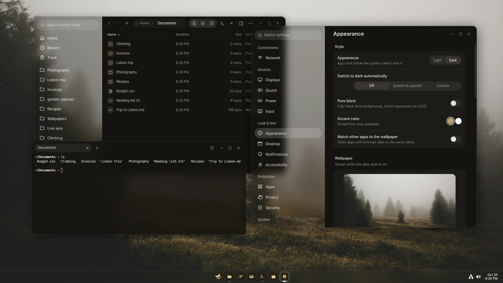
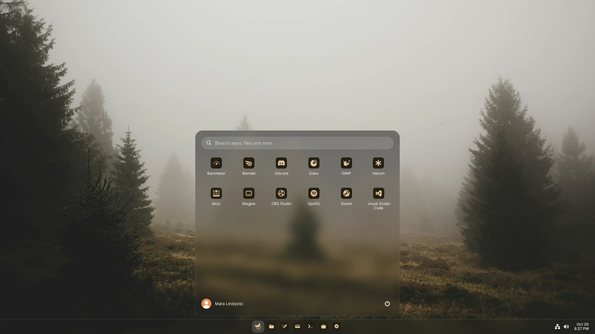
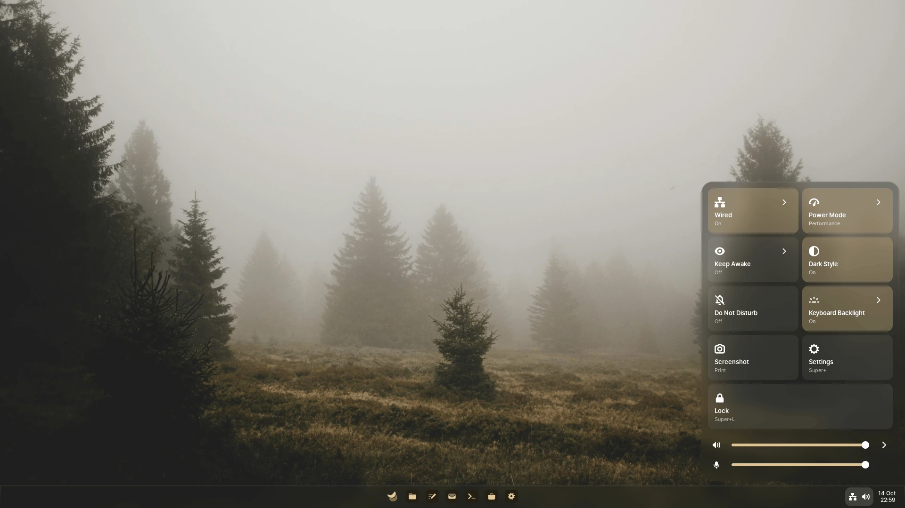

# Luft

Luft is an operating system for PCs, built on Fedora. It has its own desktop, its own apps and a startup that's signed from the moment you press the power button. It ships as one sealed image that updates as a whole and can always go back to the version before.

<picture>
  <source media="(prefers-color-scheme: light)" srcset="web/docs/src/assets/shots/desktop-light.webp">
  
</picture>

## What makes it different

- **Its own desktop.** Kestrel has a taskbar, Start with search across apps, settings and the text of your files, quick settings, snap layouts, and a board where windows sit side by side on an endless canvas. Its colors come from your wallpaper, and the apps follow.
- **Its own apps.** Settings, Rover for files, Magpie for photos, videos, music and PDFs, Mailman for mail, Draft for text and code, Tern for the terminal, Schelf for everything else from Flathub and AppImages.
- **Updates you don't think about.** The system updates as a whole at the next restart. If a new version doesn't start, Luft goes back to the one that did.
- **A startup you can trust.** Secure Boot can stay on, the disk unlocks with the TPM, a keyring keeps your passwords and passkeys, and new USB devices wait while the screen is locked.
- **Easy to try.** Meet Luft gets a Windows or Linux PC ready without a USB stick, and Luft installs next to Windows or in place of another Linux, keeping your files.

  <picture>
    <source media="(prefers-color-scheme: light)" srcset="web/docs/src/assets/shots/start-light.webp">
    
  </picture>
  <picture>
    <source media="(prefers-color-scheme: light)" srcset="web/docs/src/assets/shots/quick-settings-light.webp">
    
  </picture>

## Get Luft

- **[luft.computer](https://luft.computer)** shows what Luft is like, and its [download page](https://luft.computer/download) has Meet Luft and the USB stick images.
- **[docs.luft.computer](https://docs.luft.computer)** covers trying it, installing it and everything after.
- **[get.luft.computer](https://get.luft.computer/nightly/latest.json)** hosts the files themselves, each with a `.sha256` next to it. `nightly/latest.json` names the newest ISO.

Luft needs a 64-bit PC with UEFI. A TPM 2.0 is optional and lets an encrypted disk unlock without a password.

## Status

Luft is young. There's no stable release yet: the downloads are nightly builds of `main`, and systems installed from them keep following the nightlies. Expect rough edges, and keep a backup of anything you care about.

## What's in this repository

| Folder | What it is |
| --- | --- |
| [`os`](os/README.md) | The system image, the USB stick and VMs to try them in |
| [`kestrel`](kestrel/README.md) | The desktop, login screen, keyring, passkeys and session services |
| [`apps`](apps) | Luft's apps, one folder each, and Install Luft and Meet Luft |
| [`packages`](packages) | Code the apps and services share: the native app shell, D-Bus and translations, libraries for the system's parts in `system` and the UI kit in `web` |
| [`services`](services) | Luft's own system and session services: updates, sleep, online accounts, dictation, Windows next to Luft and app thumbnails |
| [`boot`](boot/sushi/README.md) | The Sushi boot splash and the SushiBoot boot menu |
| [`security`](security/README.md) | Secure Boot, TPM unlock, disk encryption and USB protection |
| [`web`](web) | The [website](web/site/README.md), the [docs](web/docs/README.md) and what they [share](web/shared/README.md) |
| [`docs`](docs) | Notes on how things work underneath, also published on the docs site under Reference |

Each folder's README says what it is and how to build it.

## Building and contributing

[Building Luft](https://docs.luft.computer/developers/building/) sets up a development machine and runs Kestrel in a window, the apps on their own, and the image and USB stick in VMs. [How Luft fits together](https://docs.luft.computer/developers/architecture/) is the place to start reading, and [Contributing](https://docs.luft.computer/developers/contributing/) covers how to send changes. Problems and ideas go in [the issues](https://github.com/Lantharos/Luft/issues).

## Translating

Luft is translated on [Hosted Weblate](https://hosted.weblate.org/projects/luft/), in the browser, with no programming needed. Weblate sends the work back here as pull requests, and it reaches the nightlies once merged. [Translating Luft](https://docs.luft.computer/developers/translating/) covers getting started and the style guide for each language.

## License and credits

Luft is licensed under the GNU General Public License, version 3 or later ([`LICENSE`](LICENSE)). Kestrel's engine comes from [GNOME Shell](https://gitlab.gnome.org/GNOME/gnome-shell) and the patches to [Mutter](https://gitlab.gnome.org/GNOME/mutter) follow Mutter, so both stay GPL-2.0-or-later (`kestrel/engine/COPYING`).

- Luft is built on [Fedora](https://fedoraproject.org) and [bootc](https://bootc-dev.github.io/bootc/), and its apps on [Sabine](https://github.com/Lantharos/Sabine).
- [Open Runde](https://github.com/lauridskern/open-runde) and [Maple Mono](https://github.com/subframe7536/maple-font) are under the SIL Open Font License, in `packages/web/ui/fonts`.
- [Helium](https://helium.computer), the default browser, is GPL-3.0 and comes unchanged from [its releases](https://github.com/imputnet/helium-linux/releases).
- The wallpapers are photos from [Unsplash](https://unsplash.com/license), credited in [`CREDITS`](os/image/files/usr/share/backgrounds/luft/CREDITS).
