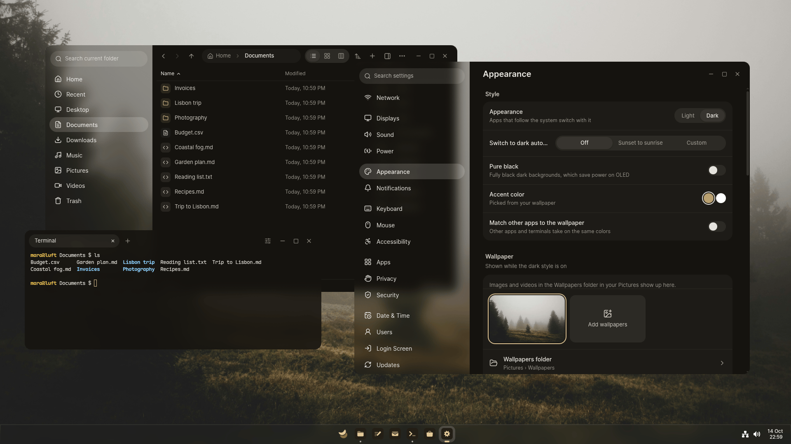
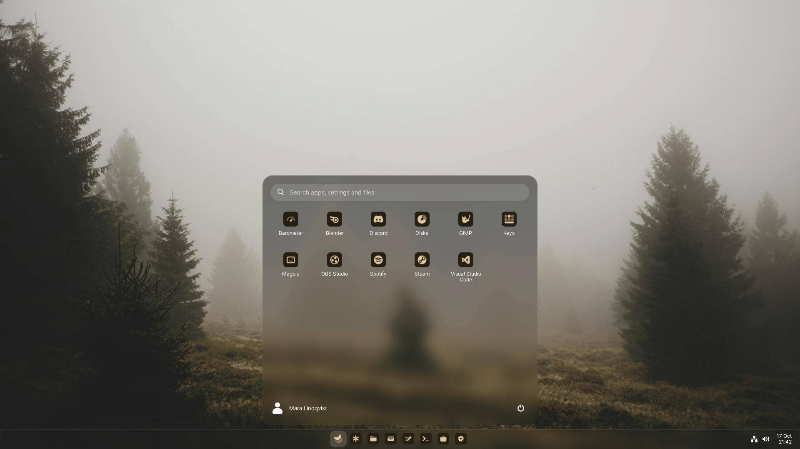
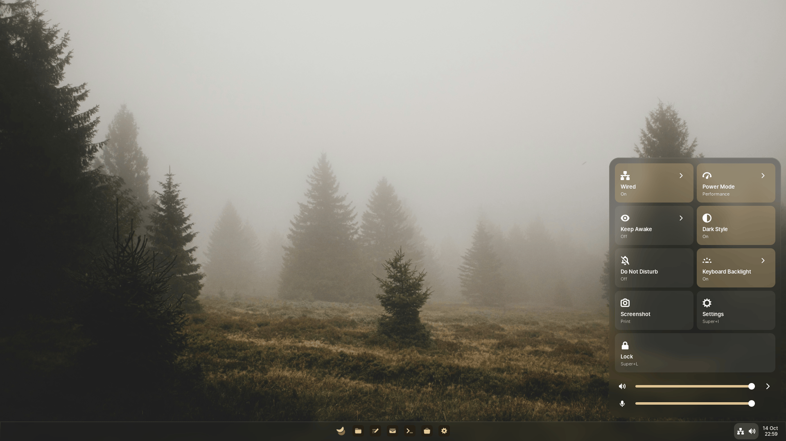

# Luft

Luft is an operating system built on Fedora. It has its own desktop and login screen (Kestrel), its own apps, a keyring with passkeys, and its own boot chain, from a flicker-free splash to TPM disk unlock. It ships as a sealed, signed image that updates as a whole and can always go back to the version before.

<picture>
  <source media="(prefers-color-scheme: light)" srcset="docs/screenshots/desktop-light.png">
  
</picture>

<p>
  <picture>
    <source media="(prefers-color-scheme: light)" srcset="docs/screenshots/start-light.png">
    
  </picture>
  <picture>
    <source media="(prefers-color-scheme: light)" srcset="docs/screenshots/quick-settings-light.png">
    
  </picture>
</p>

## Get Luft

Download [luft-latest.iso](https://get.luft.lanth.me/luft-latest.iso), write it to a USB stick of 4 GB or more, and start the computer from it. The stick opens Install Luft, which can put Luft next to Windows, on a whole drive, or just let you try it. Secure Boot can stay on.

On a Windows PC, [Meet Luft](docs/meet.md) does the same without a stick: it makes room next to Windows and restarts into Luft to try or install it.

Luft needs a 64-bit PC with UEFI. A TPM 2.0 is optional, and lets an encrypted disk unlock without a password. [Installing Luft](docs/install.md) has the details.

After that, updates arrive in Settings and install at the next restart. Apps come from Schelf (Flathub and AppImages), and command-line tools from a Toolbox container that Schelf manages too. Luft comes with [Helium](https://helium.computer), the Chromium-based browser by imput, as the default browser; it updates on its own and can be removed in Schelf like any other app.

## Build it

The image is built with Podman from [`os`](os/README.md), without root:

```sh
os/image/build.sh        # the system image, localhost/luft:45
os/iso/build.sh          # the USB stick, os/iso/state/luft-VERSION.iso
os/vm/disk.sh && SECURE_BOOT=1 os/vm/run.sh   # install it in a VM and start it
```

Releases are built and signed in CI and published as `ghcr.io/lantharos/luft:45` and `:45-nvidia`.

## Parts

| Path | What it is |
| --- | --- |
| [`os`](os/README.md) | The bootc image, the USB stick and a VM to try them |
| [`kestrel`](kestrel/README.md) | Desktop shell, login screen and session services |
| [`kestrel/compositor`](kestrel/compositor/README.md) | Kestrel's Mutter 51 patch series |
| [`kestrel/engine`](kestrel/engine/README.md) | The native shell, started from GNOME Shell 51.0 |
| [`kestrel/keyring`](kestrel/keyring/README.md) | Luft Keyring: secrets, SSH agent and GnuPG pinentry |
| [`kestrel/passkeys`](kestrel/passkeys/README.md) | Luft Passkeys, offered to every browser as a security key |
| [`kestrel/peek`](kestrel/README.md#seeing-and-using-windows-from-other-programs) | `peek`, which lets programs see and use windows |
| [`boot/sushi`](boot/sushi/README.md) | Sushi boot splash and the SushiBoot boot menu |
| [`security`](security/README.md) | trustd (Secure Boot key, TPM unlock, encryption) and USB protection |
| [`apps/barometer`](apps/barometer/README.md) | System monitor |
| [`apps/disks`](apps/disks/README.md) | Drives, partitions, encryption and disk images |
| [`apps/draft`](apps/draft/README.md) | Text and code editor |
| [`apps/keys`](apps/keys/README.md) | Keyboard layouts and input methods |
| [`apps/magpie`](apps/magpie/README.md) | Photos, videos, music, PDFs and fonts |
| [`apps/mailman`](apps/mailman/README.md) | Mail |
| [`apps/meet`](apps/meet/README.md) | Meet Luft, which gets a Windows PC ready for Luft without a USB stick |
| [`apps/rover`](apps/rover/README.md) | Files, and the file chooser |
| [`apps/schelf`](apps/schelf/README.md) | Apps from Flathub and AppImages, and command-line tools |
| [`apps/settings`](apps/settings/README.md) | Settings |
| [`apps/setup`](apps/setup/README.md) | Install Luft: the installer and first-start setup |
| [`apps/signin`](apps/signin/README.md) | Wi-Fi sign-in pages |
| [`apps/tern`](apps/tern/README.md) | Terminal |
| [`packages/ui`](packages/ui/README.md) | Shared Svelte components and styles |
| [`packages/app`](packages/app/README.md) | Shared native window, palette, D-Bus and portal code |
| [`packages/dbus`](packages/dbus/README.md) | D-Bus connections and service properties for apps and system services |
| [`packages/disks`](packages/disks/README.md) | Drives, partitions and resizing through UDisks |
| [`packages/fingerprint`](packages/fingerprint/README.md) | Fingerprint readers through fprintd |
| [`packages/network`](packages/network/README.md) | Wi-Fi, wired and VPN connections through NetworkManager |
| [`packages/software`](packages/software/README.md) | System updates, Flatpak, AppImages and Toolbox tools |
| [`packages/windows`](packages/windows/README.md) | Windows on the same computer: Fast Startup, its clock and its Bluetooth devices |

Guides: [installing](docs/install.md), [boot and recovery](docs/boot.md), [security model](docs/security.md), [wallpaper colors](docs/appearance.md), [Kestrel prompts](docs/prompts.md) and [testing](docs/testing.md).

## Develop

Day-to-day work happens on a Fedora 45 machine, in test sessions that change nothing on it. Install [Bun](https://bun.sh), Rust and the [Sabine](https://github.com/Lantharos/Sabine) CLI, then the build dependencies:

```sh
sudo dnf builddep mutter
sudo dnf install $(cat os/image/packages/build.txt) greetd gstreamer1-plugin-gtk4 cldr-emoji-annotation
```

Build Kestrel into `kestrel/build` and try it in a window:

```sh
bun install
(cd kestrel/ui && bun install --frozen-lockfile)
kestrel/compositor/build.sh
meson setup kestrel/build kestrel/engine -Dpkg_config_path="$PWD/kestrel/run/mutter-install/lib/pkgconfig" --prefix="$PWD/kestrel/install"
meson compile -C kestrel/build
kestrel/tools/session.sh nested
```

After pulling, `meson compile -C kestrel/build` is enough. Each app runs from its own folder with `bun run desktop:dev`.

| Command | Checks |
| --- | --- |
| `kestrel/tools/session.sh capture` | Every Kestrel surface and the apps in isolated headless sessions, with screenshots |
| `bun run check` in `kestrel/ui`, an app or `packages/ui` | Type checks |
| `cargo test` in a Rust crate | Its unit tests |
| `make check` in `boot/sushi` | Sushi and SushiBoot |
| `apps/setup/installer/vm/run.sh` | A real install in a VM |

Session options, VMs and the other checks are in [docs/testing.md](docs/testing.md).

## License

Kestrel's engine is GPL-2.0-or-later, inherited from GNOME Shell (`kestrel/engine/COPYING`), and so are the Mutter patches. The rest is MIT unless a folder says otherwise. Open Runde and Maple Mono are under the SIL Open Font License, in `packages/ui/fonts`. Helium is GPL-3.0 and comes unchanged from [its releases](https://github.com/imputnet/helium-linux/releases), with its source at [imputnet/helium](https://github.com/imputnet/helium). The wallpapers are photos under the [Unsplash License](https://unsplash.com/license), credited in [`os/image/files/usr/share/backgrounds/luft/CREDITS`](os/image/files/usr/share/backgrounds/luft/CREDITS).
