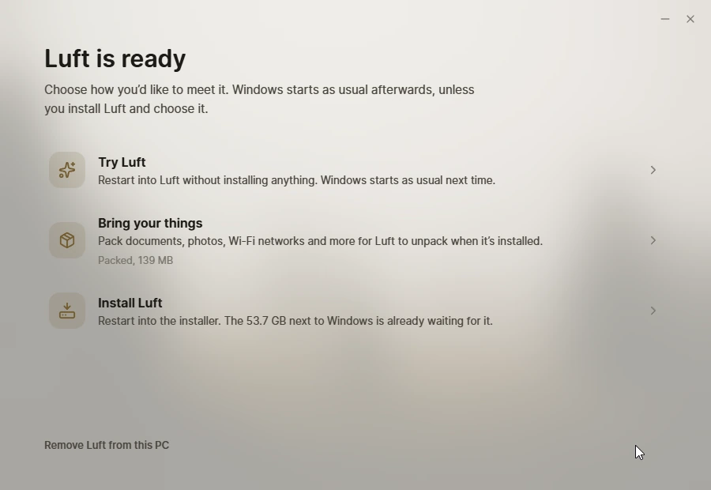

# Meet Luft



Meet Luft is an app for Windows and Linux that gets a computer ready for Luft without a USB stick. It checks the computer, makes room next to the system already there, and restarts into Luft once to try it, install it or, on Linux, replace the old system and keep your files. It can also make a USB stick, and take everything back out again. Using it is described in [the docs](https://docs.luft.computer/start/meet-luft/), and how it works in [docs/meet.md](../../docs/meet.md).

## Parts

| Folder | What it is |
| --- | --- |
| `src` | The window: check, room, moving box, ready |
| `desktop` | Its native side. It runs as you, and starts itself a second time with administrator rights (UAC on Windows, `pkexec` on Linux) for the disk and firmware work |
| `vm` | A Windows 11 VM, and Fedora VMs in `vm/linux`, with Secure Boot and a TPM to try it in |

What Meet Luft leaves on the drive for Install Luft, and the moving box's format, are in [packages/meet](../../packages/meet).

## Build

Install dependencies once from the repository root with `bun install`, then from this folder:

```sh
bun run check
bun run build
cargo build --release --target x86_64-pc-windows-gnu --manifest-path desktop/Cargo.toml   # Windows, with MinGW
sabine bundle . --target appimage --release                                               # Linux, needs appimagetool
```

To run the Windows build, put `meet.exe` in a folder with a `resources` folder holding `Sabine.toml`, `dist` and `public`. The [Meet Luft workflow](../../.github/workflows/meet.yml) builds the Windows setup program and the AppImage and publishes them to get.luft.computer.

`--nightly`, or Ctrl+Shift+N in the app, uses nightly builds instead of releases. Ctrl+Shift+L saves the newest logs from Try Luft to the desktop as a zip.

## Testing

```sh
vm/run.sh base             # installs Windows 11 from vm/state/windows11-eval.iso, unattended
vm/run.sh plain            # a copy of it to test in; delete vm/state/plain to start over
SECOND=64G vm/run.sh two   # with an empty second drive
vm/control.py plain wait   # until Windows is up
vm/control.py plain run 'Get-Partition'
vm/control.py plain screenshot shot.png
vm/iso.sh                  # a Luft ISO with this checkout's installer, Install Luft and trustd
```

For Linux:

```sh
vm/linux/install.sh fedora              # Fedora Workstation as it installs: btrfs root and home, a second drive
vm/linux/install.sh home                # ext4 with a separate /home
vm/linux/install.sh single              # everything on one ext4 partition
vm/linux/run.sh try fedora              # a copy of it to test in
ISO=vm/state/luft-meet.iso vm/linux/run.sh try    # start Luft from a stick in it
ISO=vm/state/luft-meet.iso MEMORY=4096 vm/linux/run.sh blank empty   # or on an empty drive
vm/control.py try run 'lsblk'           # as root, through the guest agent
```

The Fedora VMs sign in as `ada` (password `meet-vm`, also root's). `SHARE=folder` shares a folder as 9p tag `share`.

The Windows VM needs the Windows 11 Enterprise evaluation ISO and the virtio-win ISO in `vm/state`. Windows signs in as `ada` (password `meet-vm`) by itself, with the QEMU guest agent, so `control.py` can run PowerShell as SYSTEM, copy files and click and type.
