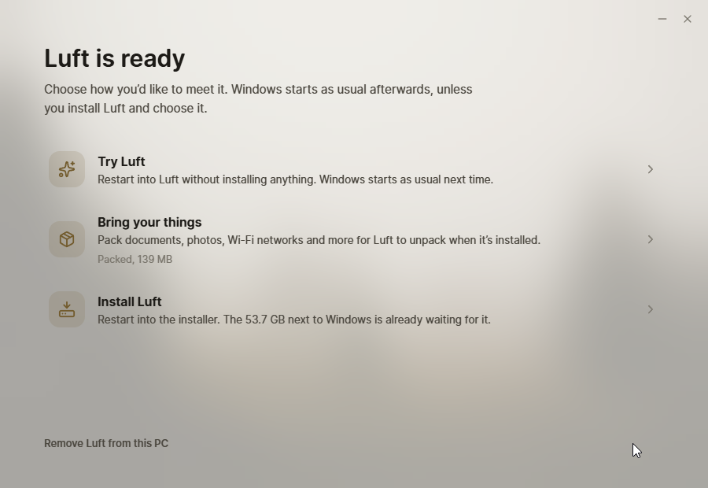

# Meet Luft



An app for Windows and Linux that gets a computer ready for Luft without a USB stick. It checks the computer, puts the live Luft system next to the one already there and restarts into it once, to try Luft, install it or, on Linux, replace the old system and keep your files. On Windows it makes room with Windows' own tools and can pack files and settings into a moving box; on Linux it keeps Luft in a folder and repartitions nothing. It can take everything back out again, and make a USB stick, or add Luft to a Ventoy stick. How it fits together is in [docs/meet.md](../../docs/meet.md).

Builds aren't code-signed yet, so Windows SmartScreen asks before the first start ("More info", then "Run anyway").

## Parts

| Folder | What it is |
| --- | --- |
| `src` | The window: check, room, moving box, ready |
| `desktop` | Its native side. It runs as you, and starts itself a second time with administrator rights (UAC on Windows, `pkexec` on Linux) for the disk and firmware work |
| `vm` | A Windows 11 VM, and Fedora VMs in `vm/linux`, with Secure Boot and a TPM to try it in |

What Meet Luft leaves on the drive for Install Luft, and the moving box's format, are in [packages/meet](../../packages/meet).

## Build

Install dependencies once from the repository root with `bun install`, then from this directory:

```sh
bun run check
bun run build
cargo build --release --target x86_64-pc-windows-gnu --manifest-path desktop/Cargo.toml
```

On Linux, `sabine bundle . --target appimage --release` makes `Meet Luft.AppImage` (it needs `appimagetool`). The Windows build cross-compiles from Linux with MinGW. To run it, put `meet.exe` in a folder with a `resources` folder holding `Sabine.toml`, `dist` and `public`; the first start sets up Sabine. Releases come from the [Meet Luft workflow](../../.github/workflows/meet.yml) on Windows: push a `meet-vVERSION` tag matching `Sabine.toml`, or start it by hand for a test build. It publishes `meet-luft.exe` (a setup program) to the GitHub release and to `get.luft.lanth.me` when the R2 secrets are set.

Start it with `--nightly`, or press Ctrl+Shift+N in it, to use nightly builds instead of releases. Ctrl+Shift+N again switches back.

Ctrl+Shift+L saves the newest logs from Try Luft to the desktop as a zip. Where Luft keeps them is in [docs/meet.md](../../docs/meet.md#logs-from-try-luft).

## Testing

```sh
vm/run.sh base             # installs Windows 11 from vm/state/windows11-eval.iso, unattended
vm/run.sh plain            # a copy of it to test in; delete vm/state/plain to start over
vm/control.py plain wait   # until Windows is up
vm/control.py plain run 'Get-Partition'
vm/control.py plain screenshot shot.png
vm/iso.sh                  # Luft ISOs with this checkout's installer, Install Luft and trustd
```

For Linux:

```sh
vm/linux/install.sh fedora              # Fedora Workstation as it installs: btrfs root and home, a second drive
vm/linux/install.sh home                # ext4 with a separate /home
vm/linux/install.sh single              # everything on one ext4 partition
vm/linux/run.sh try fedora              # a copy of it to test in
ISO=vm/state/luft-meet.iso vm/linux/run.sh try    # start Luft from a stick in it
ISO=vm/state/luft-meet.iso MEMORY=4096 vm/linux/run.sh blank empty   # or on an empty drive
vm/control.py try run 'lsblk'           # as root, through the guest agent
```

`vm/iso.sh standard nvidia` builds the sticks with a single image instead. Their live session and the systems they install have the guest agent too.

The Fedora VMs sign in as `ada` (password `meet-vm`, also root's). `SHARE=folder` shares a folder as 9p tag `share`.

The Windows VM needs the Windows 11 Enterprise evaluation ISO and the virtio-win ISO in `vm/state`. Windows signs in as `ada` (password `meet-vm`) by itself, with the QEMU guest agent, so `control.py` can run PowerShell as SYSTEM, copy files and click and type.
