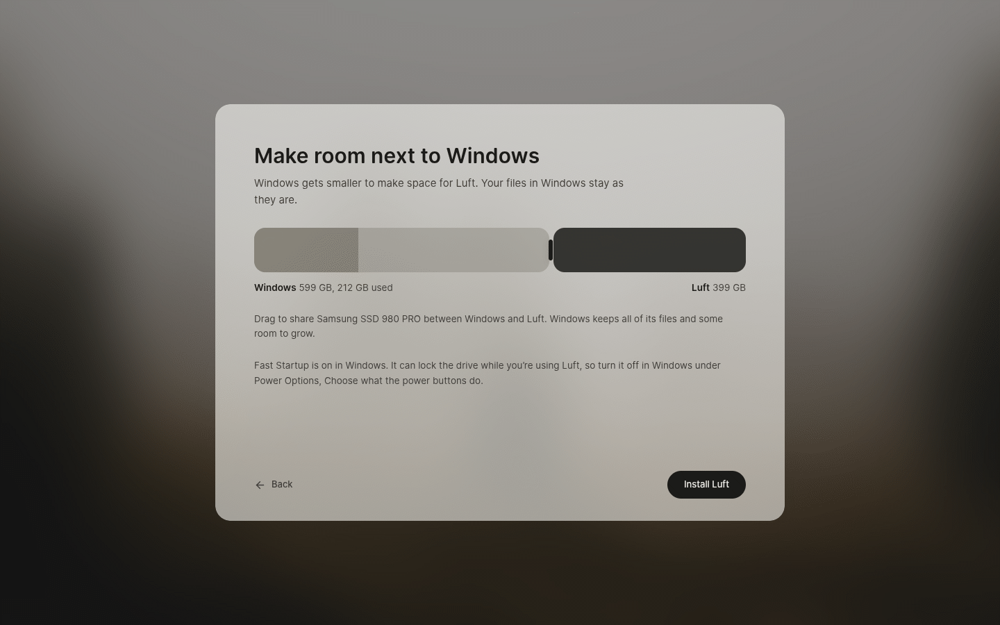

# Install Luft

Installs Luft from the USB stick and sets up a new computer the first time it starts. It is built with Sabine and Svelte, and runs in Kestrel's setup mode: one window over the blurred wallpaper, with no panel. How the whole install goes is in [docs/install.md](../../docs/install.md).



## Features

- Language, keyboard and time zone, guessed from the firmware, from Windows on the same computer, and from the network once online
- Alongside Windows with a size bar, on a whole drive, in free space made with Disks, or just trying Luft from the stick, next to Windows' small EFI system partition too
- Replaces a Linux system whose home folder is a btrfs subvolume or its own partition, keeping files, accounts with their passwords and IDs, network connections, SSH host keys, other drives and command-line tools (as a Toolbox), and keeps a btrfs system as `old-system` until it's removed
- Refuses to touch Windows while it's hibernating, locked with BitLocker or needs a check, and says what to do in Windows
- Next to Windows, offers to turn off Fast Startup, keep the clock right in both and bring Bluetooth devices paired in Windows
- Started by [Meet Luft](../meet/README.md) from Windows, goes straight to the room Meet Luft made, fills in your name and regional settings from the moving box, unpacks it into the new account, and takes back Meet Luft's partitions after the first sign-in
- Copies Luft in the background while you connect to Wi-Fi and make your account
- Picks the NVIDIA image when the computer has an NVIDIA graphics card
- Before the restart, explains the one blue Secure Boot screen with pictures and the code to type
- On first start, right after signing in: asks again if the blue screen was skipped, offers encryption with a recovery key and a fingerprint when there's a reader, then hands over to the desktop
- Listed in Start only on the stick

## Parts

| Folder | What it is |
| --- | --- |
| `src` | The setup window |
| `desktop` | Its native side: regional settings, NetworkManager, the installer and trustd |
| `installer` | `luft-installer`, the system service that partitions, copies and configures (`com.lantharos.Installer1`) |

## Build and run

Install dependencies once from the repository root with `bun install`, then from this directory:

```sh
bun run desktop:dev      # Vite dev server and the native window
bun run check            # svelte-check
bun run desktop:build    # production web build and release binary
cargo build --release --manifest-path installer/Cargo.toml
```

## Install

The setup app and `luft-installer` ship in Luft's image. The installer's files, from `installer/data`:

| File | Goes to |
| --- | --- |
| `luft-installer` | `/usr/libexec/luft-installer` |
| `install.toml` | `/usr/lib/luft-installer/install.toml` |
| `com.lantharos.Installer1.conf` | `/usr/share/dbus-1/system.d/` |
| `com.lantharos.Installer1.service` | `/usr/share/dbus-1/system-services/` |
| `luft-installer.service` | `/usr/lib/systemd/system/` |
| `com.lantharos.installer.policy` | `/usr/share/polkit-1/actions/` |
| `luft-installer.cil` | `/usr/share/selinux/packages/`, loaded with `semodule -i`; runs the service as SELinux's `install_t`, which bootc needs |

## Testing

```sh
KESTREL_DEV_APPS=setup kestrel/tools/session.sh setup
```

runs the setup checks in a headless Kestrel in setup mode, against stand-ins for the installer, NetworkManager, trustd and logind, and saves a screenshot of every step.

`cargo test` in `installer` covers the partition layout, the files written into the new system and reading Windows from an NTFS image; changing Windows is tested in [packages/windows](../../packages/windows/README.md).

```sh
installer/vm/run.sh
```

installs for real in a VM: it seals a test image from `localhost/luft-system:45` (made by `os/image/build.sh`) with the installer, starts it with four spare drives, installs onto an empty drive, into free space next to an existing partition and next to a Windows-like drive with a 100 MB EFI system partition with `bootc install to-filesystem`, checks the account, regional settings, first sign-in and the startup files on the EFI system partition, checks that only the new account can end setup, checks that Windows' files and boot files stay, then starts both installed drives with UEFI. It needs Podman, QEMU with KVM and OVMF; everything lives in `installer/target/vm`. `LUFT_STICK_IMAGE=nvidia` makes the stick carry only the NVIDIA image, to check that it still installs and updates from `luft:45-nvidia`.
