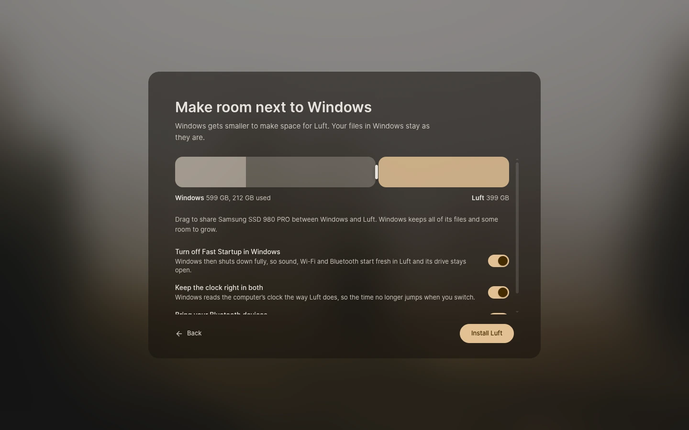

# Install Luft

Install Luft puts Luft on a computer from the USB stick or from Meet Luft, next to Windows, on a whole drive or in place of another Linux, and sets the computer up the first time it starts. It runs in Kestrel's setup mode: one window over the blurred wallpaper, with no taskbar. The steps are described in [Install from a USB stick](https://docs.luft.computer/start/usb-stick/), and what happens underneath in [docs/install.md](../../docs/install.md).



## Parts

| Folder | What it is |
| --- | --- |
| `src` | The setup window |
| `desktop` | Its native side: regional settings, NetworkManager, the installer and trustd |
| `installer` | `luft-installer`, the system service that partitions, copies and configures (`com.lantharos.Installer1`) |

## Build and run

Install dependencies once from the repository root with `bun install`, then from this folder:

```sh
bun run desktop:dev      # Vite dev server and the native window
bun run check            # svelte-check
bun run desktop:build    # production web build and release binary
cargo build --release --manifest-path installer/Cargo.toml
```

The setup app and `luft-installer` ship in Luft's image; the installer's D-Bus, systemd, polkit and SELinux files are in `installer/data`.

## Testing

```sh
bun run desktop:build
kestrel/tools/session.sh setup
```

runs the setup checks in a headless Kestrel in setup mode, against stand-ins for the installer, NetworkManager, trustd and logind, and saves a screenshot of every step.

`cargo test` in `installer` covers the partition layout, the files written into the new system and reading Windows from an NTFS image; changing Windows is tested in [packages/system/windows](../../packages/system/windows/README.md).

```sh
installer/vm/run.sh
```

installs for real in a VM: onto an empty drive, into free space, and next to a Windows-like drive with a small EFI system partition, then checks the new account, the first sign-in, that Windows' files stay, and that every installed drive starts. It needs Podman, QEMU with KVM, OVMF and `localhost/luft-system:45` from `os/image/build.sh`. `LUFT_STICK_IMAGE=nvidia` checks the NVIDIA image instead.
