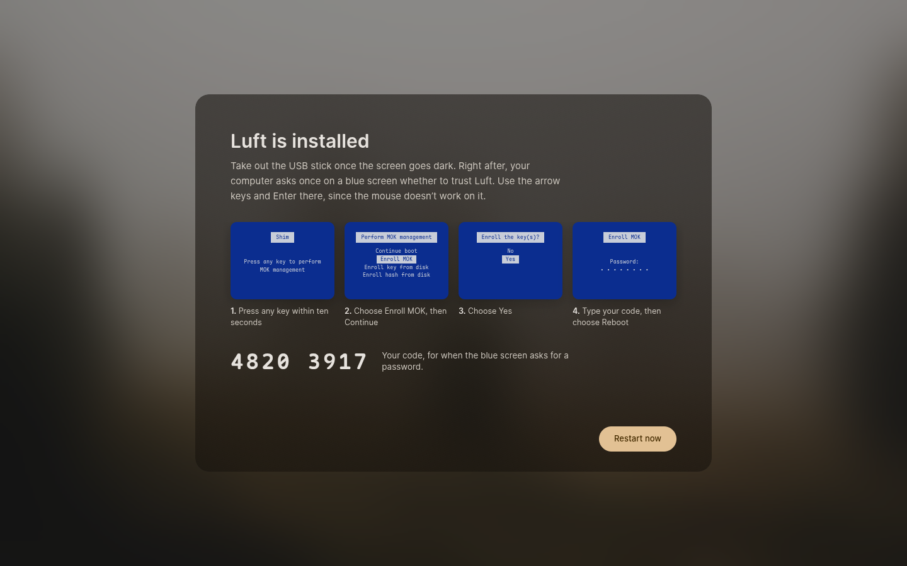

# Installing Luft

How Luft gets from the USB stick onto a computer, and what happens the first time it starts. The pieces are the [Install Luft](../apps/setup/README.md) app, its `luft-installer` service and Kestrel's setup mode.

## From the USB stick

Download [luft-latest.iso](https://get.luft.lanth.me/luft-latest.iso) (checksum: [luft-latest.iso.sha256](https://get.luft.lanth.me/luft-latest.iso.sha256)) and write it to a USB stick of 4 GB or more with Fedora Media Writer, balenaEtcher or Rufus (in DD mode). Start the computer from the stick with the firmware's boot menu, usually F12, F11 or Esc while the logo shows. Secure Boot can stay on.

For testing, [luft-nightly.iso](https://get.luft.lanth.me/luft-nightly.iso) ([checksum](https://get.luft.lanth.me/luft-nightly.iso.sha256)) is built from the latest nightly image, and computers installed from it keep updating to nightly images. [Testing on real hardware](hardware-testing.md) lists what to try.

The stick starts straight into Install Luft, over the blurred wallpaper. Holding Esc while it starts shows a menu with a basic graphics mode for screens that stay dark.

1. **Language, keyboard and time zone.** Guessed from the firmware's language, from Windows if it's on the computer, and from the network once you're online.
2. **Where Luft goes.**
   - *Alongside Windows* makes Windows' partition smaller and puts Luft in the room it frees. Drag the bar to choose how much each gets; Windows keeps its files and at least 20 GB to grow.
   - *Use a whole drive* erases one drive.
   - *Just try Luft* goes to the desktop on the stick and changes nothing.
   - *Custom* opens Disks, where you can make free space your own way, then pick it.
3. **Wi-Fi**, optional. Luft is already copying by now.
4. **Your account.** Name, user name and password.
5. **Restart.** When Secure Boot is on, Install Luft first shows the blue screen that comes right after the restart, and the code to type there. Take out the stick once the screen goes dark.



Copying starts as soon as you confirm where Luft goes. Nothing changes on any drive before that.

### When Windows can't be made smaller

| What you see | What to do |
| --- | --- |
| Windows is locked with BitLocker | Turn off device encryption in Windows, or shrink its drive in Disk Management and choose the free space under Custom |
| Windows is asleep or shut down with Fast Startup | Start Windows, hold Shift while choosing Shut down, then start from the stick again |
| Windows' drive needs a check | Restart Windows once |
| Windows needs almost all of its drive | Free up space in Windows |

### Next to Windows

When Luft goes next to Windows, it offers three things, each with its own switch:

- **Turn off Fast Startup in Windows.** With Fast Startup, Shut down in Windows is really a kind of hibernation: Windows' drive stays in use, and sound, Wi-Fi and Bluetooth can start in Luft in the state Windows left them. Luft changes the setting in Windows' registry while Windows is fully off, and keeps a copy of the registry as it was in `Windows\System32\config\SYSTEM.luft-backup`.
- **Keep the clock right in both.** Windows keeps the computer's clock in local time and Luft in UTC, so the time jumps when you switch. Luft asks Windows to use UTC too (`RealTimeIsUniversal`). Luft itself always stays on UTC.
- **Bring your Bluetooth devices.** Devices paired in Windows work in Luft right away. Later pairings come over from Settings, Bluetooth.

Windows' registry is only changed when Windows was shut down fully and isn't locked with BitLocker. To do it yourself in Windows instead: open Control Panel, Power Options, Choose what the power buttons do, and clear *Turn on fast startup*; for the clock, run `reg add "HKLM\System\CurrentControlSet\Control\TimeZoneInformation" /v RealTimeIsUniversal /t REG_DWORD /d 1 /f` in a terminal opened as administrator.

Windows updates sometimes turn Fast Startup back on. When Luft starts after Windows was hibernated or fast-started, it resets the sound chips before anything uses them and, once, explains Fast Startup with a notification that can turn it off when Windows is fully shut down. Windows' drive shows up in Files; while Windows is asleep it opens read-only, so nothing Windows still has open gets changed.

## From Windows, without a stick

[Meet Luft](meet.md) makes room next to Windows, puts the live system there and restarts into Install Luft, with *Alongside Windows* already set to that room. It works with BitLocker on, and can bring files and settings along in a moving box.

## What goes on the drive

| Partition | Size | Holds |
| --- | --- | --- |
| EFI system partition | 1 GB | Shim, SushiBoot and a signed startup image for each version of Luft. A drive that already has one, such as Windows', shares it when it has 1 GB or more |
| Luft startup | 2 GB, FAT | The signed startup images, when the drive's EFI system partition is smaller than 1 GB, as Windows' usually is. Shim and SushiBoot still go on the EFI system partition, next to Windows' boot files |
| Luft | The rest, btrfs | The system and your files |

Luft starts with UEFI only.

The system is a bootc image from `ghcr.io/lantharos/luft`, or the `-nvidia` variant when the computer has an NVIDIA graphics card. It updates from there.

## The first start

Luft starts at the login screen with your new account. Sign in with the password you chose, and Install Luft opens over the blurred wallpaper for the last steps before the desktop appears. When your time zone is in another country than your language, it also sets your region formats to that country, so a German time zone starts calendars on Monday. You can change the first day of the week in Settings, under Date and time.

When Secure Boot is on, your computer asks once whether to trust Luft, on a blue screen right after the restart. Install Luft shows that screen before the restart, with an eight-digit code: press a key within ten seconds, choose *Enroll MOK*, *Continue*, *Yes*, type the code and choose *Reboot*. The blue screen only takes the arrow keys and Enter. If it's skipped, Luft still starts and asks again at the next restart. Details are in [Boot and recovery](boot.md#adding-lufts-secure-boot-key).

1. **Secure Boot**, only when the blue screen was skipped. Install Luft gets a new code and restarts to ask again.
2. **Encryption**, optional. Luft encrypts the disk in the background after the next restart. With a TPM it unlocks by itself; without one it asks for a passphrase. Keep the recovery key it shows somewhere else.
3. **Fingerprint**, optional, when the computer has a reader. Add a finger to sign in and unlock with it.
4. **Done.** The desktop opens, or the computer restarts when one of the steps needs it.

Every step can be skipped. Secure Boot and encryption are in Settings under Security, fingerprints under Users.

Luft also picks a few things for you: the display scale from the screen's size and resolution (125% on most 14" to 16" laptop screens, 200% on sharper ones), and tap to click on touchpads. Both can be changed in Settings.

## Graphics on the stick

The stick runs on the open-source drivers, including nouveau on NVIDIA graphics cards. Nouveau drives cards up to the GeForce RTX 50 series through NVIDIA's own GSP firmware, which the stick carries, so setup looks the same as anywhere else. Installing picks the image with NVIDIA's driver when there's an NVIDIA card. A card newer than the stick's kernel falls back to the firmware's screen, which is slower but enough for setup; the basic graphics mode in the Esc menu does the same on purpose.

## For image builders

`/usr/lib/luft-installer/install.toml` says what to install:

```toml
# smallest-system = 34359738368       # bytes; drives or spaces below it aren't offered

[images.default]
source = "containers-storage:ghcr.io/lantharos/luft:45"   # where the stick has the image
size = 5286520084                                         # bytes installed, for the progress bar
```

The image ships only the settings above the `[images]` tables. The stick's build adds a table for each image it carries, with the size Podman reports for it. `[images.nvidia]` is used on computers with an NVIDIA graphics card. Updates come from the reference in `/usr/share/luft/image-reference` (`ghcr.io/lantharos/luft:45`, or `:45-nightly` in nightly images; the image build's `IMAGE_REFERENCE` sets it), with `-nvidia` added for the NVIDIA image.

- The stick ([os/iso](../os/iso)) keeps both images in a read-only image store on the stick, which the session there adds to Podman's storage, so `containers-storage:` sources install without a network.
- Its kernel command line has `rd.live.image`, which tells the installer it's on the stick. greetd signs the passwordless `live` account in with `kestrel-session --setup` as its `initial_session`, and polkit allows that account everything, installing included. Install Luft is listed in Start only there.
- Kernel arguments come from the image (`/usr/lib/bootc/kargs.d`), sealed into its startup image.
- When the drive's EFI system partition is smaller than 1 GB, the installer adds a 2 GB XBOOTLDR partition (type `bc13c2ff-59e6-4262-a352-b275fd6f7172`, FAT) in front of Luft's, and bootc keeps the startup images and boot entries there. Luft's image carries a bootc with that change ([os/image/patches/bootc](../os/image/patches/bootc)).
- After copying, the installer puts shim and SushiBoot on the EFI system partition with `trustctl startup install`, and, when Secure Boot is on, queues Luft's key for shim and publishes the code as `SecureBootCode`.
- After copying, the installer writes the locale, keyboard, time zone, host name and the account into the new system, plus `/var/lib/luft-installer/first-boot` with the account's name. `FinishFirstBoot` removes that file, and only that account may call it.

`kestrel-session --setup` runs Kestrel in setup mode until Install Luft finishes, then starts the normal session. `kestrel-session` does the same on its own when `/var/lib/luft-installer/first-boot` names the person signing in. Setup mode shows the firmware logo while Sushi hands over, fades in the blurred wallpaper with the window, and ends on that same wallpaper, so the desktop takes over without a flash. It also serves the portal's appearance settings and Luft's palette, so apps in setup look like they do on the desktop.
