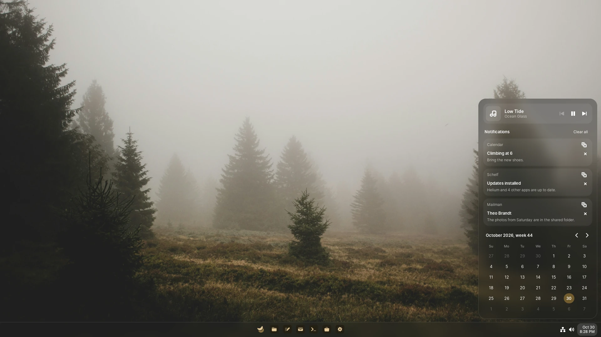

# Kestrel

Kestrel is Luft's desktop and login screen. It runs on its own patched Mutter 51 and brings its own taskbar, Start, quick settings, notification center, lock screen, session manager, settings service and portal backend. What it does for people is in the [docs](https://docs.luft.computer/desktop/overview/).

<picture>
  <source media="(prefers-color-scheme: light)" srcset="../web/docs/src/assets/shots/notification-center-light.webp">
  
</picture>

| Folder | What it is |
| --- | --- |
| [`engine`](engine/README.md) | The native shell in C, started from GNOME Shell 51.0 |
| `ui` | Everything the shell does on top of the engine, in TypeScript: window management, the lock screen, notifications, the taskbar, Start, quick settings and every other surface |
| [`compositor`](compositor/README.md) | Mutter patch series |
| `settings` | `kestrel-settings`: XSETTINGS, night light, power, printing, housekeeping, time zone, browser profile locks, memory warnings |
| `search` | `kestrel-search`, the file index behind Start's search |
| `portal` | `kestrel-portal`, the desktop portal requests that need no compositor: email, printing, accounts, app choosers, launchers, USB devices, wallpapers and lockdown |
| `greeter` | `kestrel-greeter-service`, which stores the login screen's settings |
| [`keyring`](keyring/README.md) | Luft Keyring |
| [`passkeys`](passkeys/README.md) | Luft Passkeys |
| `openconnect` | `kestrel-openconnect`, OpenConnect VPN sign-in |
| `watchdog` | `kestrel-watchdog`, restarts cleanly when the GPU hangs |
| `peek` | `peek`, lets other programs see and use windows |
| `tools` | Development sessions and checks |

## Build and run

[Building Luft](https://docs.luft.computer/developers/building/) sets up the dependencies and builds Kestrel into `kestrel/build`. To try it in a window:

```sh
kestrel/tools/session.sh nested
```

`kestrel/tools/session.sh capture` runs every check headless and saves a screenshot of every surface. The other modes and options are in [docs/testing.md](../docs/testing.md).

To run your build as the real session on an installed Luft, lay it over the signed image:

```sh
os/dev/layer.sh apply      # build Kestrel the way the image does and lay it over /usr
os/dev/layer.sh status     # what's laid over, and from which commit
os/dev/layer.sh reset      # back to the signed image
```

Log out and back in after `apply` to run it. It stays across restarts and is taken off when Luft updates. [Building Luft](https://docs.luft.computer/developers/building/#on-an-installed-luft) has the details.

Its session services, settings schemas and `peek`, which lets programs see and use windows, are in [the Kestrel reference](../docs/components/kestrel.md).
