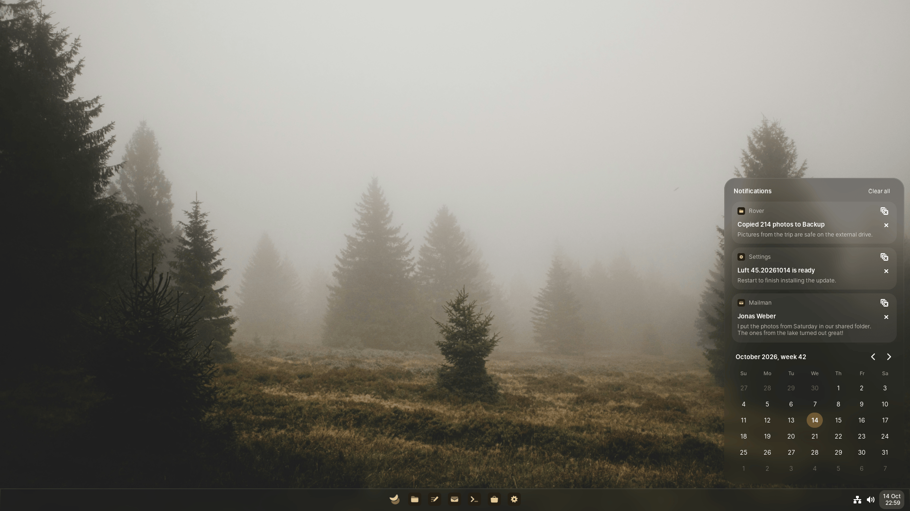

# Kestrel

Kestrel is Luft's desktop and login screen. It runs on its own patched Mutter 51 and brings its own taskbar, Start, quick settings, notification center, lock screen, session manager, settings service and portal backend. What it does for people is in the [docs](https://docs.luft.computer/desktop/overview/).

<picture>
  <source media="(prefers-color-scheme: light)" srcset="../docs/screenshots/notification-center-light.png">
  
</picture>

| Folder | What it is |
| --- | --- |
| [`engine`](engine/README.md) | The native shell, started from GNOME Shell 51.0 |
| `ui` | Taskbar, Start, quick settings and every other surface, in TypeScript |
| [`compositor`](compositor/README.md) | Mutter patch series |
| `settings` | `kestrel-settings`: XSETTINGS, night light, power, printing, housekeeping, time zone |
| `search` | `kestrel-search`, the file index behind Start's search |
| `greeter` | `kestrel-greeter-service`, which stores the login screen's settings |
| [`keyring`](keyring/README.md) | Luft Keyring |
| [`passkeys`](passkeys/README.md) | Luft Passkeys |
| `openconnect` | `kestrel-openconnect`, OpenConnect VPN sign-in |
| `watchdog` | `kestrel-watchdog`, restarts cleanly when the GPU hangs |
| `peek` | `peek`, lets other programs see and use windows |
| `tools` | Development sessions, checks and the install script |

## Build and run

[Building Luft](https://docs.luft.computer/developers/building/) sets up the dependencies and builds Kestrel into `kestrel/build`. To try it in a window:

```sh
kestrel/tools/session.sh nested
```

`kestrel/tools/session.sh capture` runs every check headless and saves a screenshot of every surface. The other modes and options are in [docs/testing.md](../docs/testing.md).

To use a development build as your session on a regular Fedora install:

```sh
kestrel/tools/install.sh install     # into /opt/kestrel, with Luft Keyring, the login screen service and the watchdog
sudo cp /opt/kestrel/share/kestrel/greetd.toml /etc/greetd/config.toml
sudo systemctl disable gdm && sudo systemctl enable greetd
```

`kestrel/tools/install.sh remove` takes it out again. If the login screen doesn't appear after a restart, press Ctrl+Alt+F3, sign in, and check `journalctl -b -u greetd`.

## peek

`peek` lets a program, such as a development tool, take pictures of windows and click and type in them. `peek --help` explains every command.

```sh
h=$(peek run --wait-window -- cargo run)   # starts it on a hidden display and prints a handle
peek window $h                             # saves a PNG and prints its path
peek click $h 120 40
peek type $h 'Hello'
peek stop $h
```

`peek run` gives the program its own hidden display, so nothing reaches your screen; `--here` opens it on your screen instead, and `--size 1920x1200:302x189mm` sets the hidden display's resolution and physical size. Windows you opened yourself need your permission first, which the privacy menu in the taskbar shows and takes back.

## Settings

Kestrel's settings live in the `com.lantharos.kestrel` schemas, and Settings changes most of them. Keyboard shortcuts are in `com.lantharos.kestrel.keybindings` and `.media-keys`, with window management in GNOME's `org.gnome.desktop.wm.keybindings`; every one is listed in [Keyboard shortcuts](https://docs.luft.computer/desktop/shortcuts/). The wallpaper palette Kestrel shares with apps is described in [docs/appearance.md](../docs/appearance.md), and its own dialogs for the keyring and GnuPG in [docs/prompts.md](../docs/prompts.md).

## Session services

| Service | Role |
| --- | --- |
| `kestrel-session` | Started by the login screen; runs `kestrel-session.target` and Kestrel's session manager in place of gnome-session |
| `kestrel-settings` | Settings service started before the shell |
| `kestrel-search` | Indexes the names and text of files in your home folder for Start, at idle priority |
| `kestrel-greeter-service` | `com.lantharos.Greeter1` on the system bus, the login screen's settings |
| `kestrel-authenticate` | Checks lock screen passwords and fingerprints through the `kestrel-unlock` PAM rules |
| `kestrel-watchdog` | Restarts the computer when the GPU is stuck ([details](../docs/boot.md#graphics-driver-stopped-responding)) |
| `kestrel-wallpaper` | Plays live wallpapers |

`kestrel-session --setup` runs Install Luft alone over the blurred wallpaper first ([docs/install.md](../docs/install.md)). The session identifies as `Kestrel;GNOME`, so apps that only recognize GNOME keep their keyring, theme and autostart behavior.
