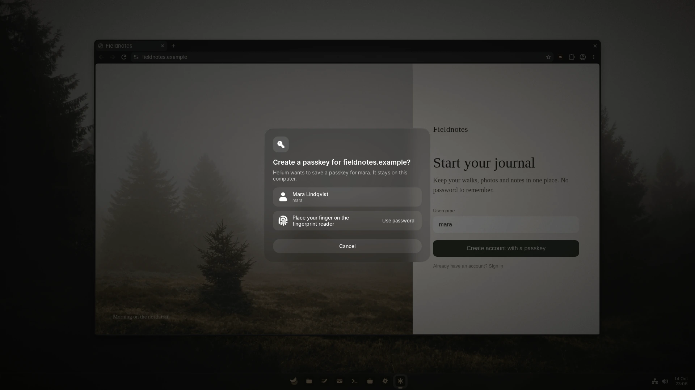

# Luft Passkeys

Luft Passkeys keeps passkeys on the computer, in [Luft Keyring](../keyring/README.md), and offers them to every browser and app. Creating a passkey or signing in with one shows a Kestrel prompt naming the site and the app, confirmed with your fingerprint or password.



Browsers see Luft Passkeys as a USB security key, so Chrome, Chromium-based browsers, Electron apps, Sabine apps and Firefox work without extensions.

| Part | Runs as | Does |
| --- | --- | --- |
| `luft-passkeys-relay` | root, one per connection, no capabilities | Creates the virtual security key (`/dev/uhid`) while its owner is at the screen, and refuses anyone without a session there |
| `luft-passkeys` | you | Speaks CTAP 2.1, asks Kestrel for confirmation, stores passkeys in Luft Keyring |
| Luft Keyring | you | Keeps passkeys in its Passkeys collection and makes every signature |
| Kestrel | you | Shows the prompt; `kestrel-authenticate` checks the fingerprint or password |

Private keys are made inside the TPM when there is one, and passkeys stay bound to the computer. Browsers treat it as a security key, so they don't offer passkeys in autofill until the [Credentials portal](https://github.com/flatpak/xdg-desktop-portal/pull/1889) lands. Using it is described in [Keyring and passkeys](https://docs.luft.computer/files/keyring-and-passkeys/).

## Development

```sh
cargo test -p luft-passkeys -p ctap -p luft-passkeys-relay
cargo clippy -p luft-passkeys -p ctap -p luft-passkeys-relay --all-targets -- -D warnings
```

`tools/check` runs Chromium and Firefox against Luft Passkeys in the Sushi VM, with a stand-in fingerprint reader:

```sh
export SUSHI_VM=~/.cache/luft-passkeys-vm
boot/sushi/scripts/vm/tree.sh && boot/sushi/scripts/vm/kestrel.sh
kestrel/passkeys/tools/check/prepare.sh && boot/sushi/scripts/vm/disk.sh
kestrel/passkeys/tools/check/run.py                     # with a TPM and a fingerprint
kestrel/passkeys/tools/check/run.py --no-tpm --password # without a TPM, with the password
```

`run.py` also takes `--browsers chromium,firefox` and `--shots <dir>` to save screenshots.

Its D-Bus interfaces and Kestrel's passkey prompt are described in [Passkey interfaces](../../docs/passkeys.md).
