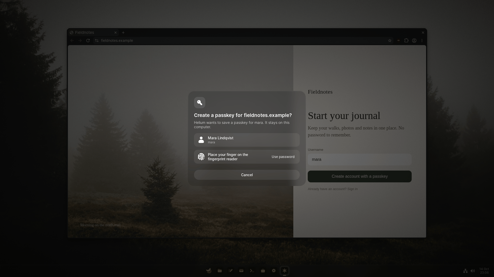

# Luft Passkeys

Luft Passkeys keeps passkeys on the computer, in [Luft Keyring](../keyring/README.md), and offers them to every browser and app. Creating a passkey or signing in with one shows a Kestrel prompt naming the site and the app, confirmed with your fingerprint or password.



Browsers see Luft Passkeys as a USB security key, so Chrome, Chromium-based browsers, Electron apps, Sabine apps and Firefox work without extensions.

| Part | Runs as | Does |
| --- | --- | --- |
| `luft-passkeys-relay` | root, one per connection, no capabilities | Creates the virtual security key (`/dev/uhid`) while its owner is at the screen, and refuses anyone without a session there |
| `luft-passkeys` | you | Speaks CTAP 2.1, asks Kestrel for confirmation, stores passkeys in Luft Keyring |
| Luft Keyring | you | Keeps passkeys in its Passkeys collection and makes every signature |
| Kestrel | you | Shows the prompt; `kestrel-authenticate` checks the fingerprint or password |

Private keys are made inside the TPM when there is one, and passkeys stay bound to the computer. Browsers treat it as a security key, so they don't offer passkeys in autofill until the [Credentials portal](https://github.com/flatpak/xdg-desktop-portal/pull/1889) lands. Using it is described in [Keyring and passkeys](https://docs.luft.computer/files/keyring-and-passkeys/).

## Install

Luft's image carries Luft Passkeys. On a regular Fedora system, after `kestrel/tools/install.sh install`:

```sh
kestrel/passkeys/install.sh install   # build, install into /opt/kestrel and enable
kestrel/passkeys/install.sh remove    # disable and remove; saved passkeys stay in the keyring
```

## Development

```sh
cd kestrel/passkeys
cargo test
cargo clippy --all-targets -- -D warnings
```

`tools/check` runs Chromium and Firefox against Luft Passkeys in the Sushi VM, with a stand-in fingerprint reader:

```sh
export SUSHI_VM=~/.cache/luft-passkeys-vm
boot/sushi/scripts/vm/tree.sh && boot/sushi/scripts/vm/kestrel.sh
kestrel/passkeys/tools/check/prepare.sh && boot/sushi/scripts/vm/disk.sh
kestrel/passkeys/tools/check/run.py                     # with a TPM and a fingerprint
kestrel/passkeys/tools/check/run.py --no-tpm --password # without a TPM, with the password
```

`run.py` also takes `--browsers chromium,firefox` and `--shots <dir>` to save screenshots.

## Interfaces

| Bus name | Object | Interface | For |
| --- | --- | --- | --- |
| `com.lantharos.Passkeys` | `/com/lantharos/Passkeys1` | `com.lantharos.Passkeys1` | Settings: `List`, `Rename`, `Delete`, `Protection` and `Ready` properties, `Changed` signal |
| `com.lantharos.Kestrel.Passkeys` | `/com/lantharos/Kestrel/Passkeys` | `com.lantharos.Kestrel.Passkeys1` | The confirmation prompt, for `luft-passkeys` only |
| `com.lantharos.Keyring1` | `/com/lantharos/Keyring1` | `com.lantharos.Keyring1.Passkeys` | Storage and signing, for `luft-passkeys` only |

Only `luft-passkeys` itself can call `Open(a{sv})` on the prompt interface, and not while the screen is locked. The details name the `purpose` (`register`, `sign-in`, `manage`, `registered` or `choose`), the `accounts`, and optionally the `site`, `site_name`, the `requester`'s process ID and a `fingerprint` hint. It returns the path of a prompt object with `com.lantharos.Kestrel.Passkeys1.Prompt`, which answers only the caller that opened it:

| Method | Does |
| --- | --- |
| `Next() → (s, a{sv})` | Waits for the person's next action: `account` with its `index`, `password` with the `password`, `confirm` or `cancel` |
| `Update(s state, s message)` | Shows `fingerprint-hint` with a message, `fingerprint-unavailable` or `wrong-password` |
| `Close()` | Closes the prompt |
